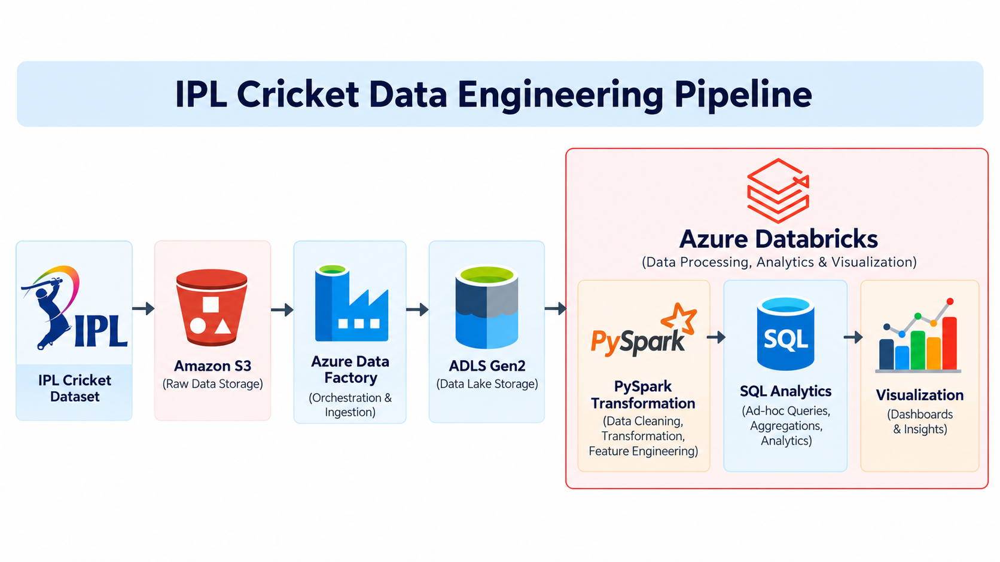

# IPL Cricket Data Engineering Pipeline

## Project Overview

This project implements an end-to-end **Azure Data Engineering Pipeline** to ingest, process, transform, and analyze Indian Premier League (IPL) cricket data using Azure cloud services.

The pipeline leverages **Azure Data Factory** for data ingestion, **Azure Data Lake Storage Gen2 (ADLS Gen2)** for storage, **Azure Databricks with PySpark** for scalable data transformations, and **Azure Synapse Analytics** for SQL-based analysis.

The goal is to build a scalable data pipeline that enables analysis of player performance, team statistics, match outcomes, and tournament trends.

## Workflow


## Tech Stack

- **Data Ingestion:** Azure Data Factory
- **Data Storage:** Amazon S3, Azure Data Lake Storage Gen2
- **Data Processing:** Azure Databricks, PySpark
- **Data Analytics:** Azure Synapse Analytics, SQL
- **File Format:** Parquet

## Pipeline Architecture

```text
Amazon S3 (IPL Cricket Data)
         |
         v
Azure Data Factory
    (Data Ingestion)
         |
         v
Azure Data Lake Storage Gen2
    (Raw Data Storage)
         |
         v
Azure Databricks + PySpark
    (Data Cleaning & Transformation)
         |
         v
Azure Data Lake Storage Gen2
    (Curated Parquet Data)
         |
         v
Azure Synapse Analytics
    (SQL-Based Analytics)
```

## Key Features

- Automated data ingestion using Azure Data Factory.
- Scalable data cleaning and transformation using PySpark.
- Cloud-based storage of raw and curated IPL datasets.
- SQL-based analytics using Azure Synapse Analytics.
- Analysis of player performance, team statistics, match outcomes, and IPL tournament trends.


**Dataset source**: [IPL Data till 2017](https://data.world/raghu543/ipl-data-till-2017)


